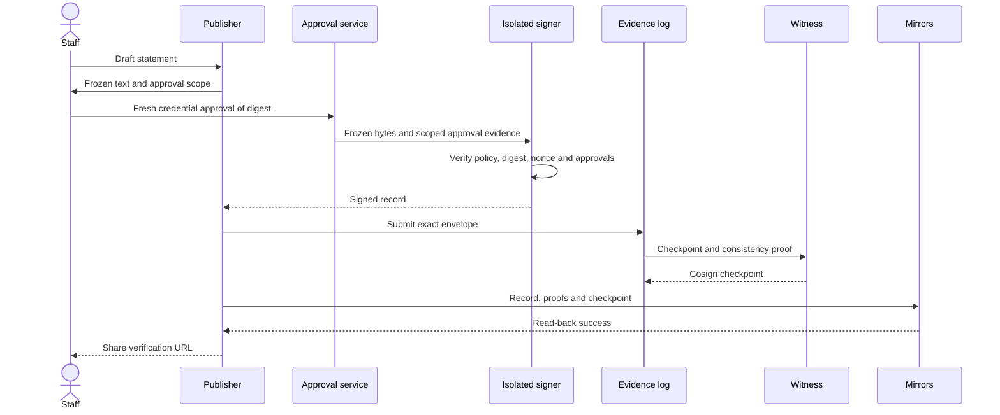
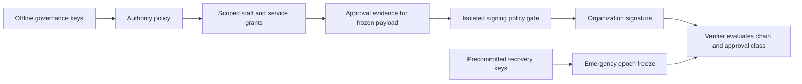
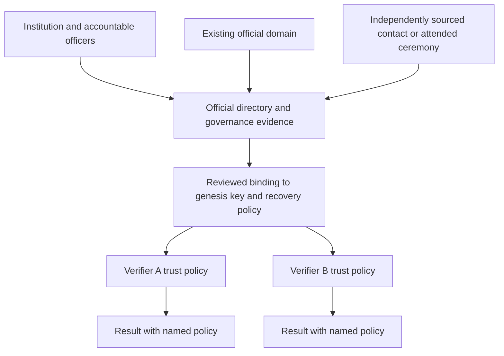
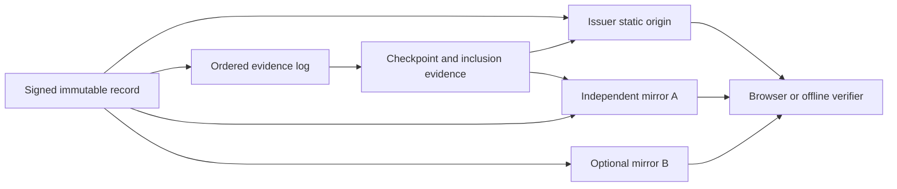
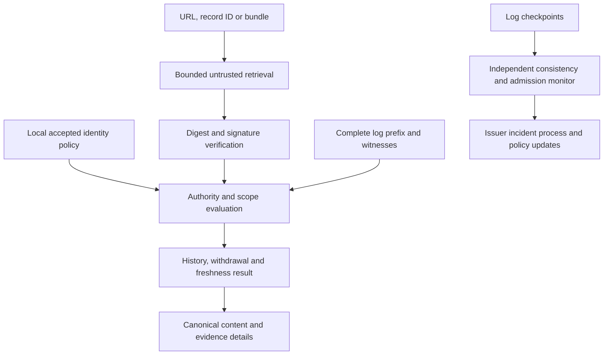
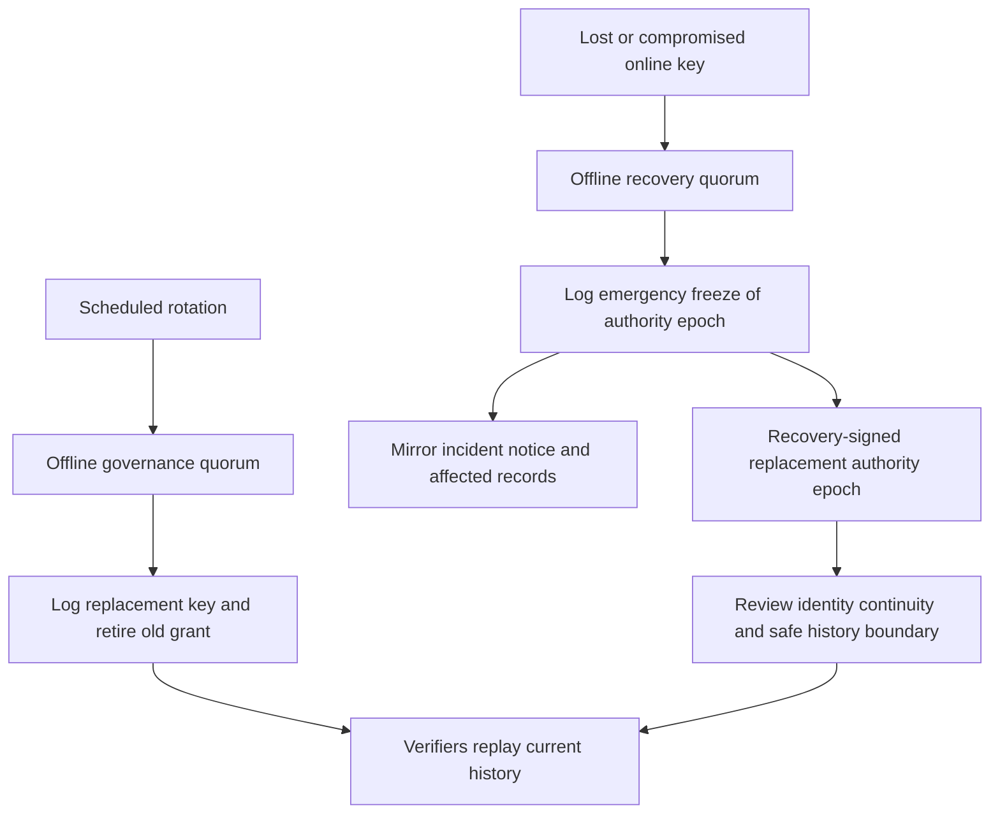

# ProofLink architecture

Design date: 2026-10-16. Status: proposed architecture, unimplemented.

The original assignment is preserved in [the brief](source/original-brief.md).
The owner's restrictive-license instruction supersedes its open-source requirement.
The owner subsequently authorized public repository visibility after review.
Public inspection is allowed; independent reuse rights are not granted by the
current license. Section I records that adoption dependency.

## The hardest problems

1. **Binding a key to a real office.** A signature proves key control; it does
   not establish who holds an office. Use documented institutional enrollment,
   multiple independent evidence channels, and verifier-selected trust policies.
   There is no universal, trust-free identity bootstrap.
2. **Representing approval honestly.** A publisher service can attest that a
   staff credential approved content. A compromised service can lie. Preserve
   that distinction; stronger credential evidence is optional and still does
   not prove informed human intent.
3. **Learning what changed.** Inclusion in a log does not prove that no later
   revocation exists. The small pilot verifies a complete bounded log prefix;
   an old inclusion proof alone never earns a current Verified result.
4. **Detecting a convincing account takeover without a link.** There is no
   cryptographic signal in an unsigned post that the reader never checks. An
   independently discovered official record and a learned expectation of signed
   statements are necessary. Universal passive detection needs integrations.
5. **Recovery without permanent vendor authority.** Precommit recovery keys and
   procedures at enrollment. If all authorized recovery material is compromised
   or lost, stop continuity and re-enroll; do not invent a secret administrator.

These are trust, evidence-distribution, and operational problems. More elaborate
identity syntax or a blockchain does not remove them.

## A. Executive architecture recommendation

Publish an immutable signed statement on the issuer's existing website and on
independent mirrors. Give each statement a content-derived identifier. A normal
browser opens an ordinary HTTPS link containing that identifier and displays the
signed text, the institution, the kind of authorization, and its evidence status.
An offline bundle allows an independent verifier to check the same signed bytes.

Use JWS with Ed25519 signatures, UTF-8 JSON payloads, SHA-256 identifiers, scoped
delegation records, and an explicitly selected institutional trust anchor. JWS
protects bytes, so the verifier never recreates signed JSON by serializing a
parsed object. These are existing mechanisms; the application record semantics
are the new protocol draft. See [PROTOCOL.md](PROTOCOL.md) and the underlying
[JWS standard](https://www.rfc-editor.org/rfc/rfc7515.html) and
[Ed25519 algorithm registration](https://www.rfc-editor.org/rfc/rfc9864.html).

Separate the public read path from the private publishing path. Public files
and the verifier require no account. A small publisher service accepts drafts,
obtains a fresh passkey approval bound to frozen content, and asks an isolated
signer to sign only an allowed record. A public append-only log orders records;
an independent witness checks continuity. Mirrors retain actual records and
proofs, not just hashes. Social distribution happens after evidence is available.

Start with one institution and one bounded evidence log. Decentralization means
independent publishers, hosts, trust policies, logs, and verifier implementations;
it does not require a global consensus network. The pilot is deliberately
federation-ready rather than globally decentralized on day one.

### What the system asserts

| Claim | Evidence and limit |
|---|---|
| These exact bytes were signed | Standard signature verification against a key |
| This office authorized that key for this purpose | Accepted enrollment and scoped authority chain |
| A staff publishing workflow approved it | Organization's signed workflow attestation; trust includes its service |
| An enrolled credential participated | Independently checked approval assertion, if supplied and supported |
| This named human understood and approved it | Cannot be guaranteed by a passkey, signature, or server assertion |
| It existed by a certain observation | Independently timed witness observation under an explicit clock assumption |
| No later admitted withdrawal is known | Complete accepted evidence through a stated fresh checkpoint |
| The claims are factually true | Outside the protocol |

### Minimum deployments

- **Phase 0:** CLI, pinned issuer fixture, offline files, independent signature
  verification. Report archival evidence; do not claim live revocation checks.
- **Phase 1 pilot:** publisher and isolated signer, existing HTTPS/static host,
  one evidence log, one independently operated witness, one independent mirror,
  and bounded complete-history verification. Label the pilot witness assumption.
- **Phase 2:** multiple institutions and independently administered witnesses;
  a reviewed quorum and log-transition profile; more scalable control-state
  proofs only after their completeness properties are demonstrated.

No mandatory blockchain, wallet, DID method, central issuer database, global
search service, browser extension, or new social media account is required.

## B. System architecture

### Publishing workflow



The private workflow has durable states: draft, frozen, awaiting approvals,
signed, awaiting inclusion, awaiting mirror, published, distribution pending,
distributed, failed. A queue retry cannot replace a payload after approval.
Signing is not publication. A social API failure does not roll back the signed
record; the UI can retry distribution independently. Sensitive statements use
two different authorized approvers and isolated approval domains where feasible.

### Authorization and signing



Routine staff publishing means authorized staff acting for an institution.
Do not display it as personal approval by the officeholder. Phase 1 supports
`organization-workflow` only. A future `credential-evidence` class must bind an
enrolled credential to an exact statement digest and verify its assertion; it
must be described as credential participation. A direct personal key signature
is another separately scoped class, not an implication of the organization key.

Passkeys protect authentication and approval ceremonies, not arbitrary content
displayed by a compromised web page. Their public-key operations are scoped to
a relying party. Use a maintained WebAuthn implementation; don't turn a login
assertion into an Ed25519 message signature. See
[WebAuthn Level 3](https://www.w3.org/TR/2026/REC-webauthn-3-20260825/).

### Identity and trust establishment



Enrollment creates a dossier: legal/institutional name, jurisdiction, office
versus individual identity, official directory references, independently
obtained contact details, evidence review date, authorized signatories, genesis
key thumbprint, initial root policy hash, log identity, and recovery procedure.
At least two distinct channels must corroborate a high-impact institution;
control of two pages on the same compromised domain is one channel.

Do not publish private identity documents. Publish a minimal binding statement,
public references, accountable reviewer identity/organization, verification
method, and validity/review scope. The pilot verifier pins this binding directly.
A federation may accept signed attestations from selected municipalities,
universities, news organizations, or other trust providers. Acceptance is local
policy; one provider has no protocol-wide veto. Conflicting credible bindings
produce a visible dispute, never a silent name-based merge.

U.S. `.gov` eligibility and registration checks are useful evidence of an
institutional domain, not proof that a particular official approved a message.
See [get.gov eligibility](https://get.gov/domains/eligibility/). Identity proofing
and entitlement to act in an office remain distinct; NIST's
[identity proofing guidance](https://pages.nist.gov/800-63-4/sp800-63a.html)
addresses individuals and does not confer organizational authority.

TLS authenticates a network endpoint within its certificate validation rules.
DNSSEC authenticates DNS data; neither prevents an authorized-but-compromised
domain controller from changing content. Use them for transport/discovery, not
as an automatic replacement for pinned institutional continuity. References:
[X.509 PKI](https://www.rfc-editor.org/rfc/rfc5280.html),
[DNSSEC](https://www.rfc-editor.org/rfc/rfc4033.html).

When an official leaves office, terminate the person's grants, end the role's
term, and issue replacement grants through the institution's governance keys.
Keep office identity separate from a personal identity. Old statements preserve
their historical role context. A domain move needs signed locator updates under
the existing authority; a domain takeover must not reset pins. Institutional
capture can result in competing legal claims that cryptography cannot decide.

### Public records and replication



The signed record is authoritative for content; the selected log is authoritative
for accepted event order within that issuer's profile. A hosting URL has no
exclusive authority. Store original payload bytes, signature envelopes,
identity/grant/control records, log entries, checkpoints, and witness signatures.
Replication must include withdraw/recovery events. A hash without available
bytes is insufficient for verification or archiving.

Use filesystem/object storage paths derived from SHA-256 and ordinary HTTPS.
Mirror identities and locations are hints; validate all retrieved bytes and
signatures. Readers can use another trusted verifier with the identifier or
download a bundle. Optional IPFS distribution can transport the same artifacts,
but retention requires real pinning/hosting commitments; content addressing
alone does not guarantee availability. See
[IPFS content addressing](https://docs.ipfs.tech/concepts/content-addressing/).

The first pilot bounds a log to 512 entries and 8 MiB of total envelope data.
Routine admission stops at 448 entries or 7 MiB, whichever comes first; remaining
capacity is reserved for authenticated governance and recovery controls. Admission
must enforce both limits and deduplicate retries without consuming new slots.
Verification replays every entry through the chosen checkpoint. Refuse a
current result when a required entry is unavailable. Once a bound is exceeded,
pause expansion until a reviewed scaling profile exists; do not skip controls
based on an untrusted search response or an unsigned index. Persistent local
verified-prefix caches reduce repeated reads but are not required for readers.

### Verification and independent auditing



Keep deterministic verification separate from network retrieval. The same bytes,
policy version, evaluation time, and checkpoint snapshot must yield the same
result across implementations. Different trust policies or freshness windows may
legitimately disagree; show those inputs. A verifier server's JSON answer is a
convenience, not a transferable proof. Export the evidence required to recompute it.

Use a generic tiled transparency log and the C2SP checkpoint/witness formats;
pin exact profile versions before implementation. These are specialist community
specifications, not IETF standards. RFC 9162 defines Certificate Transparency v2
for certificates, not arbitrary ProofLink events. Do not claim CT v2 compatibility
because a product uses a Merkle tree. The selected tiled profile uses the RFC
6962 tree construction. See [tlog-tiles](https://c2sp.org/tlog-tiles@v1.0.0),
[witness protocol](https://c2sp.org/tlog-witness@v1.1.0), and
[CT v2](https://www.rfc-editor.org/rfc/rfc9162.html).

Witnesses persist their last checkpoint, verify consistency before cosigning,
and never reset that state under the same identity. One independent honest
witness gives the pilot a conditional continuity check. A later 3-of-4 quorum,
assuming at most one Byzantine witness and stable membership, gives intersecting
quorums with an honest member; 2-of-3 with one Byzantine member does not provide
that property. Witnesses must be independent in administration and key custody,
not simply different hostnames. Membership changes need overlap and a reviewed
transition protocol; dynamic quorum changes are deferred.

A witness validates append-only continuity, not institutional identity,
authorization, factual truth, timely admission, or availability of all bodies.
Monitors fetch entries, check semantics and missing submissions, gossip
checkpoints, and alert on forks or censorship. No log proves that an unsubmitted
statement never existed. Even a fresh log can omit a revocation it refused to
admit; signed submission receipts and external reporting detect some censorship,
and policy must suspend a censoring log. That is a residual trust/availability
dependency, not a cryptographic absence proof.

Publisher timestamps are claimed times. Independently observed checkpoints give
observation bounds under witness-clock assumptions, not exact publication time.
Backdated author claims do not change log order. For high-value archival dating,
an optional RFC 3161 timestamp authority adds another explicit trusted clock;
it does not establish that a human approved content. See
[RFC 3161](https://www.rfc-editor.org/rfc/rfc3161.html).

### Rotation and emergency recovery



Use different keys and operators for governance, routine signing, and emergency
recovery. Keep governance/recovery keys offline, with separately held encrypted
backups and a tested restoration ceremony. Use standard individual signatures
and a threshold policy, not custom threshold cryptography. Pilot enrollment
pins a two-of-three governance set and a separately held two-of-three recovery
set. One compromised staff or online signing key cannot grant itself root powers.

Routine retirement ends future authorization without rewriting history. A
compromise event declares a conservatively chosen safe checkpoint boundary.
Later or uncertain statements are Unverified pending review; their signatures
may still validate. Root compromise invokes the precommitted recovery quorum and
freezes the affected epoch. Recovery can bypass a blocked normal control chain.
Root and recovery sets both lost or compromised require a new enrollment and
visible continuity break. See [control semantics](PROTOCOL.md).

## C. Architecture decision records

[DECISIONS.md](DECISIONS.md) compares message formats, algorithms, identity,
authorization, storage, transparency, freshness, recovery, implementation stack,
media, and licensing. Decisions distinguish a preferred design from a tested
compatibility result. No component has yet passed implementation validation.

## D. Data and protocol specification

[PROTOCOL.md](PROTOCOL.md) defines the draft wire profile, identifiers, record
types, delegation, proofs, ordered state evaluation, result codes, and pseudocode.
Its examples are explanatory, unsigned examples, not conformance vectors.

The MVP covers public plain-text statements and exact-byte attachments by hash.
It does not infer identity from a display name or infer approval from account
control. A later media profile may reference C2PA provenance assertions. C2PA
does not establish the truth of depicted events or personal approval by an
official; platform transcoding and metadata stripping need explicit treatment.
The research baseline is the pinned
[C2PA 2.3 technical specification](https://spec.c2pa.org/specifications/specifications/2.3/specs/C2PA_Specification.html),
not a claim that 2.3 is the latest release.

## E. API design

All following paths are draft application paths. `.well-known/prooflink.json`
is a proposed discovery convention; it has no registered well-known URI status.
Normal static retrieval and downloaded bundles remain usable without it.

### Public static resources

| Resource | Purpose | Cache policy |
|---|---|---|
| `GET /prooflink/discovery.json` | Untrusted issuer/log/mirror locator hints | Short-lived; verify referenced records |
| `GET /.well-known/prooflink.json` | Optional alias of discovery | Same; later registration needed |
| `GET /prooflink/records/sha256/<hex>/payload.json` | Exact signed payload bytes | Immutable; digest required |
| `GET /prooflink/envelopes/sha256/<hex>.json` | Exact JWS envelope bytes | Immutable; digest required |
| `GET /prooflink/bundles/sha256/<hex>.json` | Immutable evidence snapshot | Immutable; never implies current state |
| `GET /prooflink/issuers/<id>/index.json` | Searchable history hints | Short-lived; absence is not evidence |
| `GET /prooflink/issuers/<id>/latest.json` | Suggested recent checkpoint/bundle | Short-lived; check clocks/high-water marks |
| `GET /verify/<record-id>` | Accessible HTML view and local verifier | Self-hosted assets; no third-party tracking |
| `GET <log-prefix>/checkpoint` and tile resources | Standard C2SP reads | Per pinned C2SP profile |

Host CORS-enabled public evidence with `Access-Control-Allow-Origin: *` and no
credentials; restrict write/auth CORS to the publisher origin. Set
`Referrer-Policy: no-referrer`, restrictive CSP, `frame-ancestors 'none'`, and
`X-Content-Type-Options: nosniff`. Avoid remote fonts, trackers, embedded social
widgets, and automatic requests to URLs inside statement text. Serving an HTML
copy without JavaScript supports reading; cryptographic execution requires JS,
a trusted independent service, or an offline tool.

### Private services

| Endpoint | Operation and authorization |
|---|---|
| `POST /api/v1/enrollments` | Private enrollment dossier, not global registration |
| `POST /api/v1/enrollments/<id>/review` | Reviewer records evidence and binding; separate governance authorization activates |
| `POST /api/v1/drafts` | Authenticated staff saves text; no signature |
| `POST /api/v1/drafts/<id>/freeze` | Produces immutable candidate payload and digest |
| `POST /api/v1/approvals/options` | Scoped, expiring, single-use credential challenge |
| `POST /api/v1/approvals/complete` | Validates assertion for frozen digest, policy and staff identity |
| `POST /api/v1/publications` | Rechecks grants and approvals, signs and queues evidence publication |
| `GET /api/v1/publications/<id>` | Staff sees durable workflow state and retry reason |
| `POST /api/v1/controls` | Submits already threshold-signed grant/rotation/withdrawal/recovery records |
| `POST /api/v1/verify` | Optional stateless convenience computation; accepts bounded uploaded evidence |

Use session authentication, fresh privileged approval, CSRF protection, per-issuer
rate limits, bounded bodies, and audit logs without reader identities. The signer
is on a separate private authenticated channel and cannot be called with arbitrary
payloads by the public service. Control administration has no email/SMS reset
that bypasses governance or recovery signatures.

Publication calls require an issuer-scoped `Idempotency-Key` and frozen digest.
Reuse with a different digest returns 409. Exact retry returns the same job.
Return 202 while inclusion/replication is pending; only `published` yields a
shareable evidence-complete result. Use 400 malformed, 401 unauthenticated,
403 unauthorized, 409 changed state, 413 over limit, 429 throttled, and 503
dependency unavailable. Do not echo secrets or untrusted HTML in error messages.

The local verification function is `verify(bundle, policy, evaluationTime)`.
It returns the structured result in the protocol. Retrieval takes record IDs
and allowlisted HTTPS origins; disable private/link-local/loopback targets,
redirect chains, embedded credentials, DNS rebinding, and arbitrary `jku` URLs.
A user-supplied URL is not permission for server-side access to internal services.

Log append is a separate service integration. C2SP tiled reads do not standardize
admission. Define the selected engine's authenticated submission adapter and
signed receipt/deadline contract in the Phase 0 spike. Read-only queries use
standard tiles and locally computed proofs, not a custom Merkle algorithm.
Historical search is a replaceable derived index, never proof of completeness.

## F. User experience

### Publishing and approval

The editor shows the exact text, issuing office, authorization class, attachments,
and required approvals. `Approve and publish` freezes the text and invokes one
fresh passkey step for routine staff publishing. Editing any signed field clears
approvals. For multiple approvers, show who is still required; another staff
member's browser confirmation cannot stand in for the official's credential.

If the signer, log, witness, or required mirror is unavailable, display
`Publication pending` with a reason and retry. Never show `Published` after only
storing a draft or obtaining a signature. Existing CMS/social accounts remain
in use; a copy/share action exports text plus the verification URL. API-based
social distribution is an optional later adapter.

### Verification page

The first screen contains the result text, the canonical statement, the recognized
institution, the authorization class, observation/freshness time, and an
`Evidence` action. Show `This verifies origin and authorization. It does not
establish whether the claims are true.` once in context. Do not label every
valid key as a recognized institution.

| Result | Suggested visible explanation |
|---|---|
| Verified | `Matches a signed record from [office], issued through its authorized staff workflow. Status checked through [time].` |
| Unverified: unsigned | `No signed record was supplied. This does not establish that the statement is false.` |
| Unverified: missing trust | `The signature is valid, but this verifier has not established who controls this issuer key.` |
| Unverified: stale | `The saved signature checks out. Current authorization or withdrawal status could not be checked.` |
| Invalid or altered | `The supplied text or evidence failed [specific check].` Do not infer motive. |
| Revoked or superseded | `The issuer withdrew this statement on [observed date]` or `The issuer replaced it with this record.` |

These are proposed product strings with placeholders, not claims about an
implemented UI. [PROTOCOL.md](PROTOCOL.md) defines the exact decision rules.

For a linked record, say that the **record** verifies. Do not imply that nearby
social text, a screenshot, a quotation, or the whole account has been checked.
An optional comparison panel accepts pasted text locally and reports exact
match, difference, or comparison unavailable. Do not upload private clipboard
contents. Platform line-wrap or typography changes may explain differences;
similarity is never signature evidence. OCR and semantic matching only find
candidates, followed by explicit comparison with signed source material.

### User journeys

| Person | Journey and boundary |
|---|---|
| Government communications employee | Uses existing editorial workflow, approves frozen routine statement with staff passkey, shares evidence link; cannot claim personal official approval |
| Elected official | Reviews sensitive text on an independent approval surface; routine MVP can only record organization workflow, while later credential evidence is clearly labeled; term departure ends grants |
| Journalist | Opens link, compares exact quotation, checks institution and authorization class, downloads bundle, checks another verifier, cites immutable record and observation date |
| Citizen | Opens link without login, reads signed content/result; with no link uses a previously known official directory/site to find the institution's feed |
| Independent verifier | Selects trust anchors, fetches bounded evidence, replays history, computes the same core result, publishes its policy/version and allows evidence export |

Use semantic HTML, keyboard access, visible focus, text statuses alongside icons,
adequate contrast, zoom/reflow, selectable text, meaningful link names, reduced
motion, and screen-reader announcements of status changes. Target
[WCAG 2.2 AA](https://www.w3.org/TR/WCAG22/). Provide an accessible non-QR URL on
printed documents. Test on inexpensive devices and constrained networks; limit
JS and evidence sizes. Accessible alternatives for approval must preserve the
authorization policy rather than silently falling back to weak recovery.

A forged screenshot or badge can visually claim any result. A fake verifier
can lie in its UI even when genuine evidence is verifiable elsewhere. Reduce
phishing with official-domain entry points, independently bookmarked verifiers,
visible full domains and issuer bindings, no login for reading, and easy export.
Ordinary browsers do not provide a trusted content-verification indicator for
this protocol. Never promise that on-page badges cannot be copied.

Reading does not require an account, cookies, fingerprint, wallet, or persistent
identifier. Hosting providers still observe IP addresses and requested paths;
HTTPS does not hide that from the host. Minimize/disable access logs, document
retention, and offer offline bundles. No claim of network anonymity is justified.

## G. Implementation architecture

Recommend TypeScript for a shared deterministic core, browser verifier, CLI,
and small Node.js publisher. Prefer current Node 24 LTS for implementation;
the docs-only repository check also runs on Node 22. Confirm exact versions
and pin them when code is introduced; the
[Node release table](https://nodejs.org/en/about/previous-releases) lists both
as LTS at the research date. Do not add a full framework before a need exists.

Proposed structure (these packages do not exist yet):

```text
packages/protocol/       strict data parsing, record and result types
packages/verify-core/    pure evidence and policy evaluation
packages/retrieval/      bounded HTTPS and local bundle loaders
apps/cli/               offline inspection and verification
apps/publisher/         private workflow, SQLite, durable outbox
services/signer/        isolated signer and approval policy gate
integrations/web/       verifier UI in the shared Capsize web workspace
conformance/            signed vectors and independent implementation results
```

Candidate libraries are [jose](https://github.com/panva/jose) for JWS and
[SimpleWebAuthn](https://simplewebauthn.dev/docs/packages/server) for publisher
authentication. A mandatory spike must verify RFC 9864 `Ed25519` identifier
support in the selected library/runtime and hardware signer. Do not assume
`EdDSA` support means the same API accepts `Ed25519`. If incompatible, use a
maintained compatible implementation or revise the profile in an ADR before
coding; no ad hoc cryptographic or header-rewriting workaround.

Use SQLite transactions for private drafts, immutable frozen bytes, approval
references, jobs, and idempotency records. Signed records live in immutable
file/object storage; the database and search index can be rebuilt from evidence.
Use a transactional outbox to bridge signing, log admission, and replication.
PostgreSQL becomes useful for multiple publisher instances; neither a database
cluster nor a message broker is needed for the first pilot.

Root keys stay offline. Production routine keys must use a separately operated
signing service with a measured supported key-protection option; hardware/HSM
support for Ed25519 is not assumed. Keep prototype software keys confined to
fixtures/local demonstrations. Security review must approve the actual custody
mechanism before public use. A signature API holding a key inside the compromised
publisher process does not provide useful isolation.

A Capsize web implementation belongs in the shared capsize-web workspace using
`@capsize/ui`, the HQ brand guide, and square corners. Use its dashboard generator
if a dashboard is needed. Protocol packages remain independent from the UI.
This design does not authorize a production website, a new deployment, or
changes to the shared UI workspace.

Deploy public static resources independently of the publisher. Use private
network access for staff APIs where practical, least-privilege service accounts,
encrypted tested backups, separate signing custody, immutable public evidence
backups, and health checks for log/witness/mirror lag. A publisher outage should
not stop archival reads. On partitions, retain historical evidence and report
stale current state; do not fabricate revocation freshness.

Testing must cover strict parser ambiguities, algorithm confusion, duplicate
JSON keys, malformed UTF-8/base64url, boundary sizes, grants and policy escalation,
replay, changed approvals, retired and compromised keys, conflicting controls,
log forks, withheld entries, clock skew, offline state, and approval XSS/CSRF.
Use property/fuzz tests for parsers and bounded state transitions, standard
library signature vectors, mutation of genuine signed fixtures, and a second
implementation in another runtime. Sharing the same verification core in two
applications does not establish independent interoperability.

Pin dependencies and toolchains with lockfiles and integrity metadata. Produce
an SBOM, preserve dependency license notices, scan secrets and vulnerabilities,
and rebuild the same source twice in clean isolated environments. Compare
artifact digests; do not call builds reproducible until that succeeds. Sign
release manifests through a separately reviewed supply-chain process. No CI or
paid service is enabled in this bootstrap. Existing Capsize local/hosted CI
conventions must be checked before adding workflows.

SDKs initially expose types, parsing, local verification, and bundle loading;
later CMS and social adapters compose those APIs. The wire protocol cannot
require this SDK, a Capsize server, or a particular language. Under the current
license, sharing any SDK or specification requires an owner-approved license.

## H. MVP roadmap

[ROADMAP.md](ROADMAP.md) gives scope, dependencies, tasks, engineering estimates,
operating cost assumptions, security gates, acceptance criteria, deferrals, and
the first ten engineering tasks. Estimates are planning ranges, not provider
quotes or promises about solo delivery speed. Security review and partner
availability can dominate elapsed time.

## I. Governance and sustainability

Current governance is Capsize LLC's project with a public repository under its
restrictive license. No independent foundation, pilot partner, specification reuse
license, or open contribution process exists.
The brief's desired public/open governance is therefore a proposed future state.

Before adoption, obtain an explicit owner decision on specification reuse,
patents, reference implementation licensing, trademarks, and security contacts.
One possible future arrangement is a permissively licensed specification and
reference verifier, with paid optional hosting and integration services. It
requires new grants; do not describe the current proprietary files as open.
Existing third-party rights are preserved independently.

For a future open protocol, use public versioned proposals, recorded decisions,
at least two independently maintained interoperable implementations, transparent
test vectors, a rotating multi-institution steering group, and an appeal process
for trust-policy disputes. Separate protocol conformance from endorsing an
institution's identity. Registries of algorithms/profiles need an auditable
change process, not one vendor's remote kill switch. Trust policy distribution
must be signed, versioned, rollback-resistant, replaceable, and explicitly chosen.
The [TUF model](https://theupdateframework.io/docs/overview/) is relevant to future
policy distribution, not an automatic solution to office identity.

Funding options include grants, institutional maintenance subscriptions, paid
publisher hosting, support, and integrations. Verification and downloading public
evidence should remain available without per-read fees or an account. Do not
sell trusted placement, make paid certificates the only accepted identity path,
or require a vendor endpoint to resolve historical records. Plan mirror custody,
maintainer succession, and emergency funds without claiming they already exist.

Priority conflicts are real: stronger fresh evidence adds services and failure
modes; independent enrollment adds reviewer cost; privacy limits analytics;
hardware approvals add friction; an immutable archive conflicts with later
deletion requests; open independent adoption conflicts with the current license.
Keep security and independently inspectable evidence ahead of convenience, while
showing failures and uncertainty instead of silently lowering the profile.

## J. Pilot deployment

Recruit one willing local office, university unit, or civic institution. No
partner is selected or contacted by this project setup. Use a non-emergency
public-information feed first; do not pilot emergency instructions. Keep the
existing CMS/social accounts, add a verification link and an official-site feed,
and train two staff approvers plus separate governance/recovery custodians.

Run an eight-week pilot after Phase 1 gates: two weeks of rehearsal and recovery
drills, then six weeks of ordinary routine notices. Aim for 30-100 notices, with
synthetic test material clearly separated from actual public communications.
An independent institution/operator runs the witness and mirror and one reviewer
implements verification from the protocol rather than copying the core library.
Budget and time ranges are in the roadmap; no expenditure is authorized here.

| Metric | Proposed acceptance target and measurement |
|---|---|
| Publishing friction | Median additional approval time under 15 seconds, p95 under 45 seconds for routine trained staff; explicit consent to timing study |
| Reader usability | At least 90% of a recruited 20-person nontechnical test group correctly distinguishes signed record, missing evidence, withdrawal, and factual truth; report sample limits |
| Independent interoperability | Two independent implementations agree on every released vector and pilot evidence snapshot under identical policy/time |
| Compromised social account simulation | Red team with only test social-account control cannot create an accepted signed record; linkless false posts remain Unverified when checked |
| Content comparison | All altered fixture quotations fail exact-match checks; genuine formatting differences are explained without a fraud claim |
| Verification latency | p95 initial result under 3 seconds on the agreed low-end device/network with the bounded pilot log; report workload and cold-cache size |
| Availability | At least 99.5% successful synthetic archival reads over pilot, with origin deliberately disabled in a drill; no uptime claim before measurement |
| Freshness and incidents | 99% of normal checkpoints observed within 5 minutes; a recovery freeze visible to online verifiers within 10 minutes in the drill |
| Privacy | No reader accounts, third-party telemetry, or cross-site identifiers; inspect actual requests and retained host logs |
| Recovery | Restore mirror and rehearse signer loss, root compromise, and unavailable witness; retain exact artifacts/results |

Use local deterministic measurements, synthetic probes, and consented usability
sessions; no covert reader analytics. Stop the pilot for false-positive Verified
results, an unresolved identity dispute, missed control events, unreviewed key
custody, or misleading product claims. Report failures and exclusions. A pilot
is evidence about a bounded deployment, not proof of general public safety.

## Six-month social account takeover challenge

Assume an attacker exclusively controls an official X account for six months,
can imitate the official, and can remove all verification links. Assume the
institution's signing/approval/recovery systems and accepted trust policy remain
independent and uncompromised.

1. **What is established:** a checked statement either matches an independently
   available signed record authorized under the accepted office policy, differs
   from such a record, or lacks evidence. The attacker's social-account access
   alone cannot produce the institution's required signature and log history.
2. **What is not established:** missing evidence does not prove account takeover,
   fraud, falsehood, or that the real office disowns an unsigned remark. The
   system cannot prove who typed a post, or whether an authentic statement lies.
3. **Discovery by a citizen:** links make one-tap comparison possible. Without
   links, the citizen must reach a known official website/directory or trusted
   independent verifier, find the institution's signed feed, and compare. The
   office can publish a signed warning and publicize it through other channels.
   Some readers will never check; this remains an unsolved adoption limit.
4. **Remaining attacks:** omission of links, fake verifier sites, unrelated valid
   links, misleading quotations, old signed statements replayed as new, suppression,
   signature-system compromise, coercion, and authentic misinformation. Display
   full signed context, date bounds and authorization; never verify an account
   from one signed post.
5. **Comparison with checking an official website:** a genuine link makes the
   content lookup short and adds exportable evidence, role attribution, stable
   history and mirrors. With no link, baseline discovery is not inherently
   simpler than checking the official site. The architecture does not claim it
   defeats a six-month impersonation for readers who never consult another source.
6. **Needed integrations:** a browser or platform could automatically discover
   expected issuer policy, compare post text, surface missing-evidence indicators
   in trusted UI, and warn about stale/replayed claims. Extensions can approximate
   this but add permissions, privacy issues, and platform parsing fragility.
   Standard browser-only pages cannot annotate arbitrary social feeds.

The revised scope is verifiable institutional statements and discoverable
independent history. Universal automatic impersonation detection is excluded.
The priority order in the brief is retained: security, independent verifiability,
simplicity, interoperability, decentralization, adoption. The current licensing
constraint remains a barrier to the public-adoption portion of that objective.

The implementation sequence ends with the exact
[first ten engineering tasks](ROADMAP.md#first-ten-engineering-tasks).
